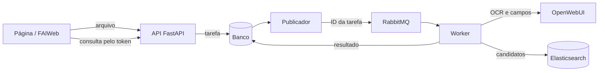

# FAI Fila

Serviço que verifica se um recibo enviado em uma prestação de contas pode ser duplicado de outro já aceito.

A API recebe um PDF, JPEG ou PNG e devolve um token na hora. A análise roda em segundo plano, e o resultado aponta os recibos candidatos e os campos que coincidem ou divergem.

> **Estado atual:** demonstração com recibos sintéticos e regras iniciais. Ainda não há autenticação de usuários e organizações, política de retenção de arquivos nem integração com o evento real de aprovação do FAIWeb.

## Como funciona



O worker obtém o texto pelo OCR/Docling do OpenWebUI, extrai os campos com uma LLM, busca recibos semelhantes no Elasticsearch e aplica regras determinísticas sobre valor, data, estabelecimento e identificador.

A análise termina com uma destas decisões:

| Decisão | Significado |
| --- | --- |
| `possible_duplicate` | Pelo menos um candidato atende às regras de suspeita |
| `no_duplicate_found` | Nenhum dos candidatos recuperados atende às regras |
| `inconclusive` | Faltam dados ou há conflitos que impedem concluir |

Verificar não cadastra: o recibo só entra na base depois de aprovado, quando o backend do FAIWeb chama uma [rota autenticada](docs/api.md#indexar-após-aprovação).

## Como executar

Requisitos:

- Python 3.12
- RabbitMQ
- Elasticsearch
- OpenWebUI com OCR/Docling e um modelo de extração

O banco padrão é SQLite, e PostgreSQL também é aceito.

```bash
python3.12 -m venv .venv
.venv/bin/python -m pip install -r requirements.txt
.venv/bin/python -m pip install torch --index-url https://download.pytorch.org/whl/cpu
.venv/bin/python -m pip install -r requirements-embeddings.txt
cp -n .env.example .env
```

Preencha o `.env` conforme a [configuração](docs/configuracao.md). Depois, gere os exemplos, carregue a base e inicie a API, o publicador e o worker:

```bash
.venv/bin/python -m scripts.generate_corpus
.venv/bin/python -m scripts.check_services
.venv/bin/python -m scripts.ingest_receipts
.venv/bin/python -m scripts.dev_stack start
```

Abra a página em <http://localhost:8010> e a documentação interativa da API em <http://localhost:8010/docs>.

Também há um [Compose](docs/docker.md) para API, publicador, worker, PostgreSQL e RabbitMQ, mas o build e a execução dos containers ainda não foram validados. Elasticsearch e OpenWebUI são externos nos dois modos.

## Como usar

1. Escolha um exemplo e clique em **Usar**, ou selecione um arquivo próprio.
2. Clique em **Verificar duplicidade** e acompanhe as etapas.
3. Confira a comparação dos campos e os candidatos encontrados.

F5 limpa a página, mas a tarefa continua no servidor. Para voltar a ela, informe o token em **Retomar uma análise**.

Pela API:

```bash
curl --fail-with-body http://localhost:8010/api/receipt-checks -F 'file=@recibo.pdf'
curl --fail-with-body http://localhost:8010/api/receipt-checks/TOKEN_DA_ANALISE
```

## Documentação

| Quero… | Guia |
| --- | --- |
| Executar em Python, ver logs e resolver problemas | [Execução](docs/execucao.md) |
| Executar com containers | [Docker](docs/docker.md) |
| Preencher o `.env` | [Configuração](docs/configuracao.md) |
| Entender a fila, a busca e as regras | [Arquitetura](docs/arquitetura.md) |
| Integrar o FAIWeb | [API](docs/api.md) |
| Gerar exemplos e rodar os testes | [Testes e exemplos](docs/testes.md) |
| Conferir o que foi validado | [Validação](docs/VALIDACAO.md) |
| Subir ou recuperar a demonstração no servidor chope | [Ambiente do chope](docs/ambiente-chope.md) |

## Estrutura

```text
app/        API, persistência, fila, worker, pipeline e regras
frontend/   Página em HTML, CSS e JavaScript
scripts/    Execução local, geração de exemplos, carga e avaliação
tests/      Testes automatizados
docs/       Guias do serviço
fixtures/   Recibos sintéticos e gabarito, gerados localmente
```
