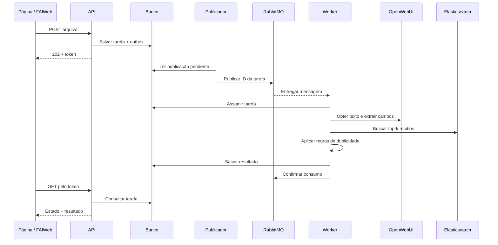

# Arquitetura

O serviço funciona como uma camada entre a aplicação web e a pipeline de análise de recibos. A API recebe a solicitação rapidamente; OCR, LLM e busca são executados por um worker. O navegador acompanha o processo consultando um token.

## Componentes

| Componente | Responsabilidade | Código |
| --- | --- | --- |
| Página web | Upload, acompanhamento, comparação e visualização | `frontend/` |
| API FastAPI | Valida arquivos, registra tarefas e fornece consultas | `app/main.py` |
| Banco | Tarefas, resultados, mensagens a publicar e cache de texto | `app/persistence.py` |
| Publicador | Envia as tarefas pendentes ao RabbitMQ | `app/dispatcher.py`, `app/messaging.py` |
| RabbitMQ | Mantém a fila durável de processamento | Configuração em `app/messaging.py` |
| Worker | Executa a pipeline e persiste o resultado | `app/worker.py`, `app/pipeline.py` |
| OpenWebUI | Acesso ao OCR/Docling existente e à LLM de extração | Cliente em `app/integrations.py` |
| Elasticsearch | Recuperação e indexação dos recibos aceitos | Cliente em `app/integrations.py` |
| Regras | Decide a suspeita a partir dos campos dos candidatos | `app/rules.py` |

## Fluxo de uma verificação

A fila transporta o ID da tarefa. O arquivo fica no armazenamento compartilhado entre API e worker; resultado e estado ficam no banco. A API responde antes da execução da análise.

## OCR e estruturação dos campos

O worker faz upload para `/api/v1/files/` do OpenWebUI e acompanha a disponibilidade do texto. Esta instalação pode disponibilizar o texto enquanto sua indexação interna ainda está pendente; o serviço usa o texto disponível porque a busca dos recibos acontece no Elasticsearch próprio.

JPEG e PNG são encapsulados em PDF antes do envio para acionar a rota de extração configurada. Isso não substitui o OCR remoto: o OpenWebUI/Docling continua responsável por obter o texto. O arquivo original recebido é preservado.

A LLM transforma o texto em campos estruturados, validados por `Receipt`: valor em centavos, moeda, data da transação, estabelecimento, documento fiscal e identificador. Campos ausentes ficam nulos. Cada campo preenchido exige evidência literal no texto; essa checagem não garante que a interpretação semântica da LLM esteja correta.

Respostas vazias, truncadas ou incompatíveis geram erro. Se uma chamada retornar HTTP 400, o cliente tenta uma vez sem as opções `response_format` e `reasoning`, mantendo a validação do JSON. Falhas transitórias seguem a política de tentativas da tarefa.

O texto extraído é armazenado por hash do arquivo e `OCR_CACHE_VERSION`. Reenviar os mesmos bytes pode reutilizar esse texto. **Extração de campos pela LLM, busca e regras são executadas novamente**, permitindo detectar uma referência aceita depois da primeira análise.

## Recuperação no Elasticsearch

O índice padrão é `fai-recibos`, separado dos índices administrativos do projeto de referência. Cada recibo curto ocupa um documento com texto, campos, metadados e um vetor.

A busca combina BM25 e kNN. As duas listas são reunidas por Reciprocal Rank Fusion (RRF), e os primeiros `TOP_K` recibos passam pelas regras. O padrão é cinco candidatos. O score de recuperação ordena candidatos; ele não é uma probabilidade de duplicidade.

Ingestão e consulta usam o mesmo modelo MiniLM multilíngue, com média normalizada de janelas de tokens. Mapping e modelo são conferidos antes da operação; busca parcial ou expirada gera erro.

## Regras de duplicidade v1

| Evidência disponível | Classificação do candidato |
| --- | --- |
| Identificador comparável e emissor iguais, sem conflitos | Possível duplicidade |
| Valor/moeda, data e estabelecimento iguais, sem conflito de identificador | Possível duplicidade |
| Coincidência forte acompanhada de campos conflitantes | Inconclusivo |
| Campos suficientes e divergentes, sem sinal forte de identidade | Distinto |
| Campos insuficientes ou extração ambígua | Inconclusivo |

Identificadores são comparáveis quando seus tipos coincidem. O estabelecimento prioriza CNPJ/CPF quando disponível nos dois recibos; um nome igual não anula conflito fiscal. Nomes e identificadores são normalizados para caixa, acentos e pontuação. Valor e data exigem igualdade.

O resultado agregado é `possible_duplicate` se algum candidato for suspeito. Sem suspeita, a análise fica `inconclusive` se faltarem dados suficientes no upload ou algum candidato for inconclusivo; nos demais casos, retorna `no_duplicate_found`. Essa última decisão se limita aos candidatos recuperados.

As regras são uma política inicial para demonstração e precisam ser calibradas com os responsáveis pelo processo.

## Indexação após aprovação

A verificação guarda o upload e a análise, mas não inclui o recibo na base aceita. Depois da aprovação, o **backend do FAIWeb** chama `POST /api/approved-receipts` com uma credencial de integração. Uma tarefa separada indexa o recibo e permite identificar reuso futuro.

A rota reaproveita texto e campos da análise aprovada. O documento é identificado por `receipt_id`, com revisões crescentes; uma revisão antiga não sobrescreve uma nova. A decisão de aprovar é externa, inclusive quando uma pessoa aceita um caso sinalizado. O contrato está em [API](api.md#indexar-após-aprovação).

## Entrega e recuperação das tarefas

Tarefa e intenção de publicação são salvas na mesma transação. Essa intenção é a **outbox**: se a API cair depois de gravar, o publicador ainda poderá enviar a mensagem.

RabbitMQ usa fila durável `fai.receipts`, mensagens persistentes, publicação obrigatoriamente roteada e confirmação do broker. O worker confirma o consumo depois de persistir resultado ou próxima tentativa. Falhas terminais seguem para `fai.receipts.dead`.

O processamento é protegido por uma posse temporária renovável, chamada lease. Um identificador de posse impede que um worker antigo grave depois da recuperação da tarefa. O publicador recupera tarefas abandonadas; reentregas de tarefas concluídas são confirmadas sem repetir o trabalho. Isso suporta reentregas, sem prometer execução exatamente uma vez.

## Limites da demonstração

A página e a consulta usam tokens imprevisíveis, sem autenticação de usuários ou isolamento entre organizações. O índice não filtra candidatos por projeto. Retenção e limpeza dos uploads locais e dos arquivos remotos, revogação de aprovação e integração com o evento real do FAIWeb ainda exigem implementação.

A visualização de PDFs da base atende aos originais sintéticos da demonstração. Documentos externos aprovados precisam de integração com seu armazenamento para disponibilizar o original na página.
